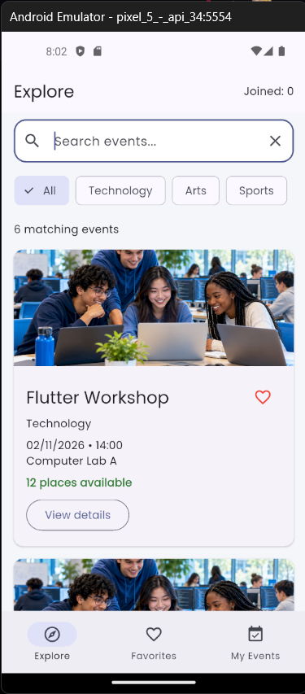
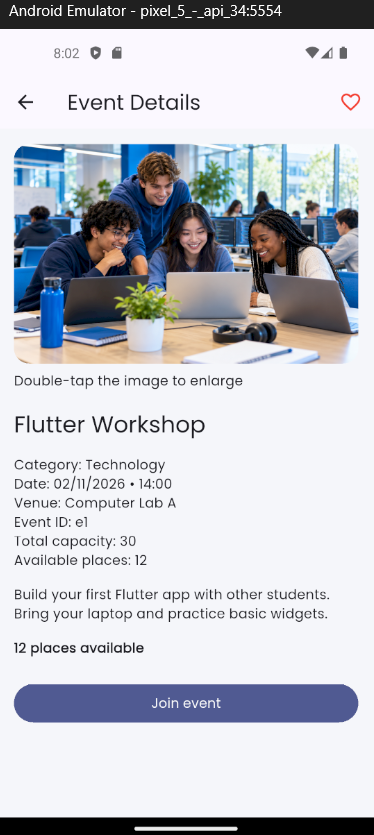
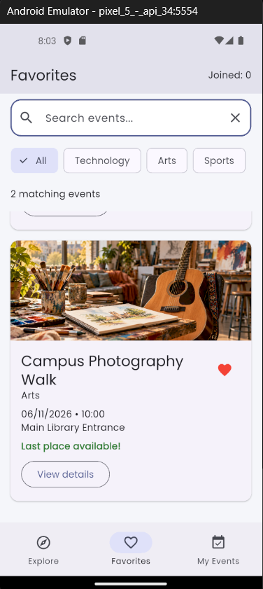
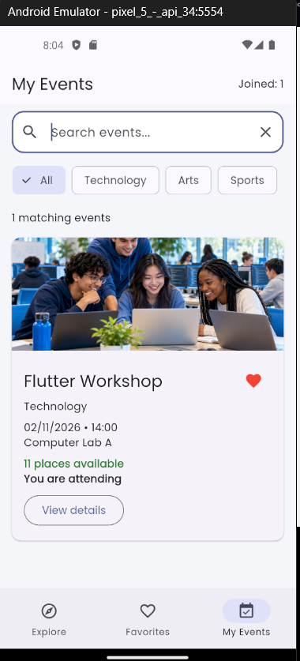

# Campus Event Explorer

BIM493 – Mobile Programming I, Assignment 1.

An offline Flutter application for discovering campus events,
saving favorites and managing participation.

## Team

- Muhammed Medenioğlu
- Fatma Bakır

Both members worked together on development and testing.

Student IDs are omitted from this public repository for privacy
and will be provided privately to the instructor.

## Features

- Six fictional events across Technology, Arts and Sports.
- Combined title search and category filtering across all three views.
- Favorites and My Events.
- Event details and double-tap image enlargement.
- Confirmation dialogs for joining and cancelling participation.
- Available-place tracking and prevention of duplicate participation.
- Local images and a bundled Poppins font.

## Setup and Run

Requires Flutter 3.47.6 on the Stable channel.

```bash
flutter pub get
flutter run
```

Start an Android emulator or connect an Android device before running.

## Flutter Version

Output of `flutter --version`:

```text
Flutter 3.47.6 • channel stable • https://github.com/flutter/flutter.git
Framework • revision 5fc346839b (3 weeks ago) • 2026-09-30 15:02:49 -0700
Engine • hash b8c8d3d8d5d0095127057f8a29ca8cc53da2167c (revision 692136cb65) (24 days ago) • 2026-09-30 00:56:59.000Z
Tools • Dart 3.13.5 • DevTools 2.60.0
```

## Screenshots

### Explore


### Event Details


### Favorites


### My Events


## Manual Checks

- [x] Joining the last available place updates participation and capacity.
- [x] Confirming cancellation restores one available place.
- [x] A full event cannot be joined.
- [x] Selecting No or dismissing a confirmation leaves data unchanged.
- [x] An unmatched search displays an empty-state message.
- [x] Double-tapping the details image opens the enlarged image.

## Asset Credits

- Category images were generated using OpenAI ChatGPT.
- Poppins font: https://fonts.google.com/specimen/Poppins
- Font license: SIL Open Font License, included in assets/fonts/OFL.txt.

## Limitations

Events are fictional. Favorites and participation are stored only
during the current app session and reset when the app restarts.
There is no backend or real reservation service.